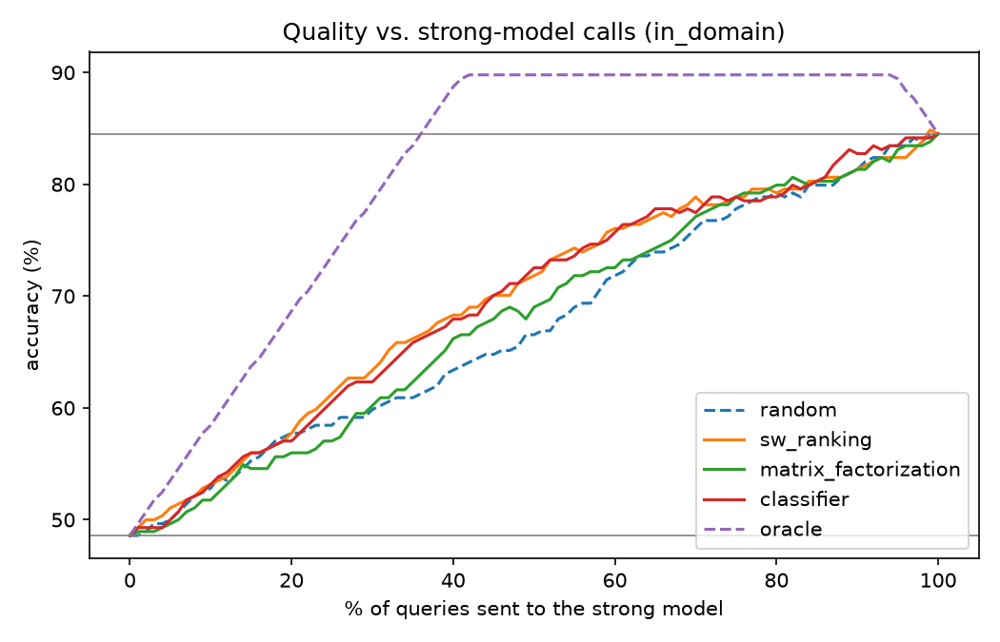
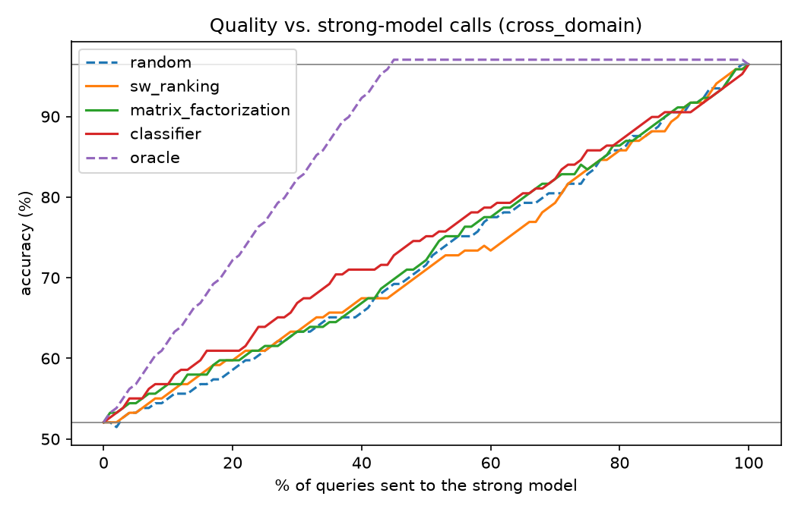

# Reproducing RouteLLM: Learned Routing Between a Weak and a Strong LLM

A scaled-down reproduction of **RouteLLM: Learning to Route LLMs with Preference Data** (Ong et al., ICLR 2025, arXiv:2406.18665).

**Question:** can a cheap learned router decide, per query, whether the small model is good enough, so we pay for the large model only when it matters?

**Setup**

| | Paper | This reproduction |
|---|---|---|
| Weak / strong models | Mixtral-8x7B / GPT-4 | ALLaM-2-7B / gpt-oss-120b at low reasoning effort (via Groq; configurable) |
| Router training signal | Chatbot Arena human preferences (+ golden-label augmentation) | Per-query correctness on MMLU and GSM8K |
| Routers | Random, SW ranking, matrix factorization, BERT classifier, causal-LLM classifier | Random, SW ranking, matrix factorization, logistic-regression classifier, oracle upper bound |
| Metrics | APGR, CPT(50%), CPT(80%) | Same definitions |
| Generalization test | Train on Arena, test on MT-Bench / MMLU / GSM8K | Train on MMLU, test on GSM8K |

## Metrics

- **PGR(c)** — performance gap recovered when a fraction `c` of queries goes to the strong model: `(acc_router − acc_weak) / (acc_strong − acc_weak)`.
- **APGR** — area under the PGR curve over `c ∈ [0, 1]`. A random router scores about 0.5. Higher is better.
- **CPT(x%)** — the smallest share of strong-model calls that recovers x% of the gap. Lower is better (it directly means lower cost).

## Run it

```bash
pip install -r requirements.txt
export OPENAI_API_KEY=<your Groq key>          # any OpenAI-compatible endpoint works, see --base_url

python generate.py --n_mmlu 400 --n_gsm8k 200   # 1. collect weak + strong responses (resumable)
python build_labels.py                          # 2. grade them -> data/labels.csv
python run_experiments.py                       # 3. train routers, compute APGR/CPT, plot curves
pytest -q tests                                 # unit tests on synthetic data, no API needed
```

Generation is about 1,200 API calls. Groq's free tier caps gpt-oss-120b at 200k tokens per day, so the run may span two days. If it stops, re-run `generate.py`; cached responses are skipped.

## Results

568 questions answered by both models (399 MMLU, 169 GSM8K).

| | MMLU | GSM8K | Overall |
|---|---|---|---|
| Weak (ALLaM-2-7B) | 50.1% | 52.1% | 50.7% |
| Strong (gpt-oss-120b) | 84.5% | 96.4% | 88.0% |
| Strong needed (strong right, weak wrong) | 39.1% | 45.0% | |

**In-domain** (random 50/50 train/test split, mean ± std over 5 seeds)

| Router | APGR ↑ | CPT(50%) ↓ | CPT(80%) ↓ | Acc @ 50% strong calls |
|---|---|---|---|---|
| random | 0.502 ± 0.018 | 50.4% ± 2.3 | 77.2% ± 2.0 | 69.9% |
| sw_ranking | 0.565 ± 0.024 | **39.8% ± 2.8** | 70.2% ± 4.8 | **74.5%** |
| matrix_factorization | 0.543 ± 0.011 | 43.2% ± 1.3 | 74.4% ± 3.7 | 73.2% |
| classifier | **0.580 ± 0.019** | 41.2% ± 3.5 | **66.6% ± 3.7** | 74.4% |
| oracle (upper bound) | 0.900 ± 0.029 | 17.8% ± 1.5 | 28.2% ± 2.2 | 91.8% |

**Cross-domain** (train on all MMLU → test on all GSM8K)

| Router | APGR ↑ | CPT(50%) ↓ | CPT(80%) ↓ | Acc @ 50% strong calls |
|---|---|---|---|---|
| random | 0.485 ± 0.018 | 52.8% | 80.6% | 73.3% |
| sw_ranking | 0.451 | 62.0% | 84.0% | 71.0% |
| matrix_factorization | 0.472 | 52.2% | 82.0% | 72.2% |
| classifier | 0.505 | 48.0% | 81.0% | 75.1% |
| oracle (upper bound) | 0.785 | 23.0% | 36.0% | 97.0% |

The train/test split is fixed in this setting, so seeds change almost nothing for the deterministic routers (std ≈ 0); only random and matrix factorization vary.




## Findings

- **Learned routing beats random in-domain, but modestly.** All three learned routers exceed random (APGR 0.54–0.58 vs 0.50). The classifier recovers 80% of the weak→strong quality gap with **66.6%** of queries sent to the strong model, versus **77.2%** for random: about **14% fewer expensive calls** at equal quality.
- **Different routers win at different budgets.** SW ranking is best at low budgets (50% of the gap with 39.8% strong calls). The classifier is best at high quality targets. Matrix factorization trails both, likely because a few hundred training queries are too few to fit its learned projection (384 → 64 dimensions), while SW ranking has no parameters to fit.
- **Most of the available gain is still on the table.** The oracle reaches APGR 0.90 against 0.58 for the best router. Embeddings from a small sentence encoder capture *what a question is about* far better than *how hard it is*.
- **Routers do not transfer across task domains.** Trained on MMLU and tested on GSM8K, every router is at or below random (APGR 0.45–0.51). GSM8K questions are all similar-looking math word problems, so topic-based similarity gives the router nothing to separate easy from hard.
- **Comparison with the paper:** _TODO — check the paper's results tables for how routers trained without benchmark-specific labels performed on MMLU/GSM8K, and how golden-label augmentation changed that, then write one or two sentences comparing._

**Limitations:** 568 queries (vs ~80k preference pairs in the paper), one model pair, and a small embedding model. 4 weak-model answers hit the token limit (repetition loops) and are graded wrong.

**Next steps:** a stronger embedding model or a fine-tuned BERT classifier (as in the paper); adding a small amount of labelled GSM8K data to the training set, to test whether a little in-domain data fixes the cross-domain failure.

## Differences from the paper, and why

1. **Correctness labels instead of human preferences.** Arena preference data is large, but the labels are noisy. Graded benchmark answers give a clean ground truth at a small scale, much like the paper's golden-label augmentation.
2. **Logistic regression instead of a fine-tuned BERT.** It keeps the full pipeline runnable on a laptop. The embeddings come from `all-MiniLM-L6-v2`.
3. **SW ranking simplified for two models.** With only two models, a similarity-weighted Bradley–Terry fit reduces to a similarity-weighted win rate, which is what `SWRankingRouter` computes.
4. **Smaller scale.** 568 queries instead of the paper's ~80k preference pairs, so results carry more variance. That is why every number is reported as mean ± std over 5 seeds.

## Files

| File | What it does |
|---|---|
| `data.py` | Samples MMLU / GSM8K items, builds prompts, grades answers |
| `generate.py` | Collects responses from both models with caching and retries |
| `build_labels.py` | Grades responses into `data/labels.csv` |
| `routers.py` | The routers (matrix factorization is written in PyTorch) |
| `routing_metrics.py` | PGR curve, APGR, CPT |
| `run_experiments.py` | Runs both experiments, writes tables and plots |